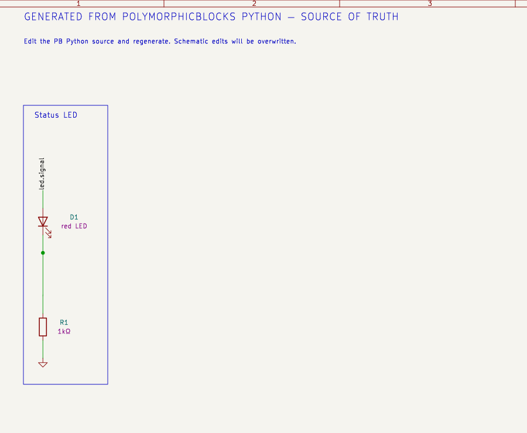
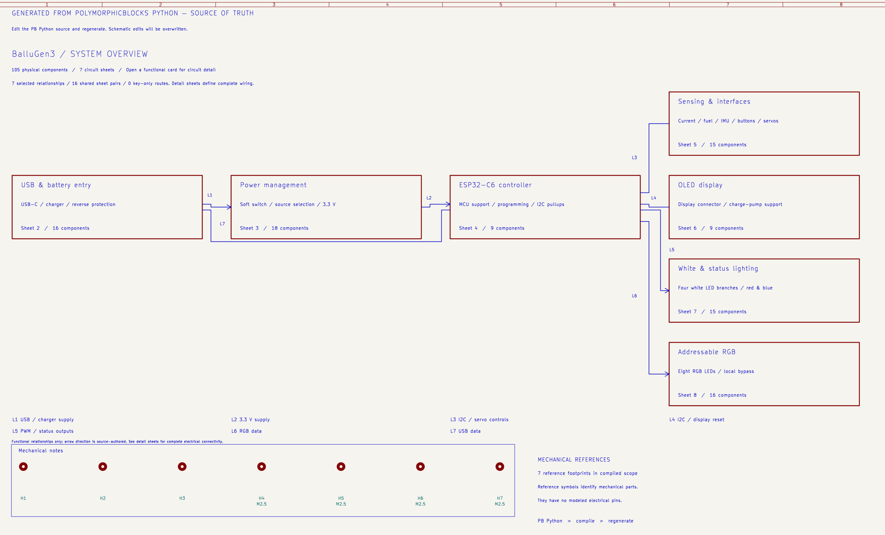
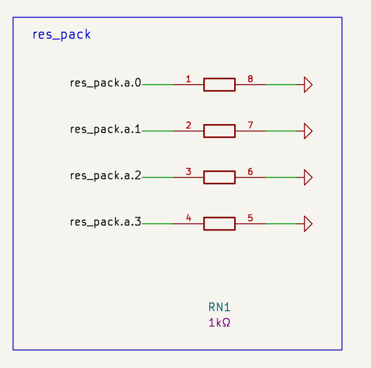
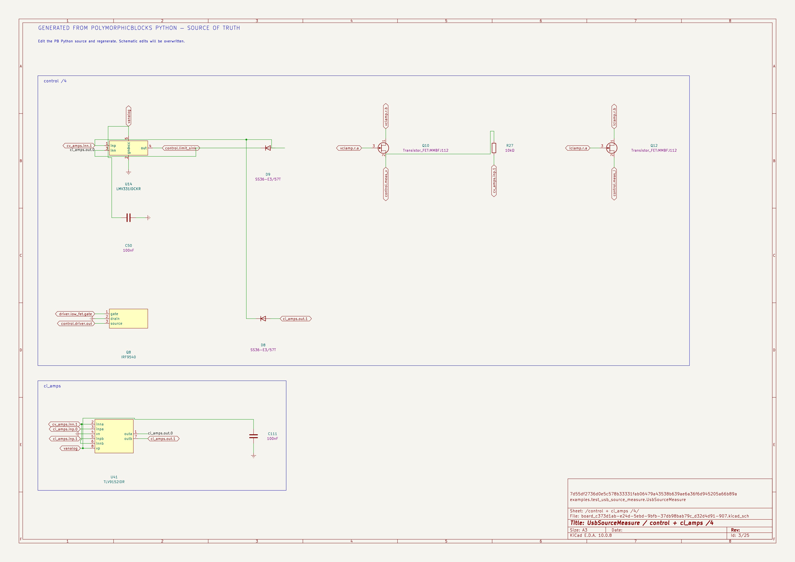
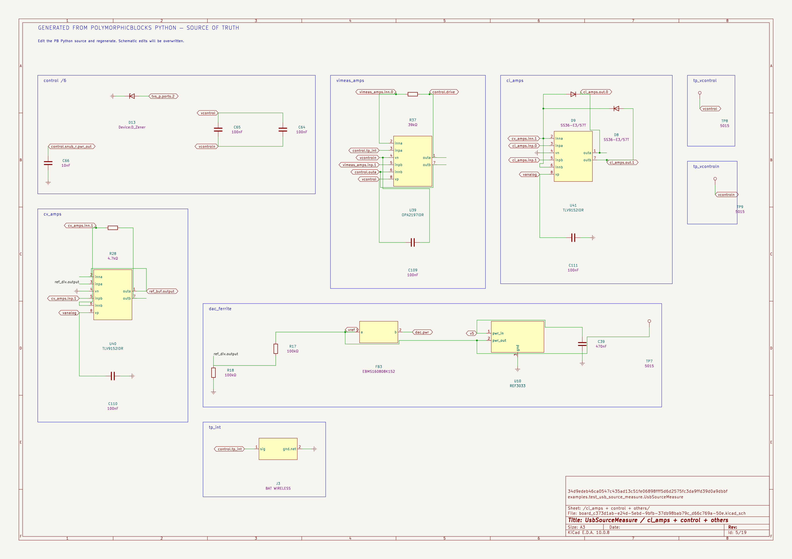

# Generated KiCad schematics

PB Python defines the parts, physical pad mappings and connectivity. Generated
schematics are a one-way view of that compiled design. Every sheet says to edit
Python and regenerate; KiCad edits are overwritten. The existing PB netlist
remains the supported PCB update workflow.

## PB owns schematic generation

The exporter is a native PB capability. Compilation, physical connectivity,
symbol resolution, functional placement, orientation search, routing, sheet
planning and KiCad serialization all run inside PB. Generation does not require
`agentic-pcb`, an MCP server, or an agent session.

Use `compile_board(..., schematic=options)` or
`compile_board_inplace(..., schematic=options)` for integrated generation, or
`KiCadSchematicExporter().export(compiled, options)` for an in-memory bundle
after successful compilation and reference assignment. The PB CLI example below
uses this same native path.

The companion agentic-pcb tools adapt these APIs for agents: they validate
requests, manage isolated candidates and provenance, and invoke native checks.
They do not supply a second schematic generator. Given identical compiled
input, options, libraries and sheet plan, the adapter and direct PB call produce
identical artifact contents. The standalone regression runs PB's CLI in a fresh
interpreter with all `agentic_pcb` imports blocked; companion parity tests compare
the actual native and adapter bundles.

## Compile and open

```python
from edg import compile_board_inplace, SchematicExportOptions

compile_board_inplace(
    MyBoard,
    schematic=SchematicExportOptions(
        design_name="MyBoard",
        symbol_library_dirs=("/usr/share/kicad/symbols",),
    ),
)
```

A runnable opt-in example is
[`examples/export_schematic.py`](../examples/export_schematic.py). Run
`python -m examples.export_schematic --output /tmp/pb-schematic-example --symbol-dir /usr/share/kicad/symbols`
from the PB checkout to generate the existing LED design in a dedicated
destination. The example uses Python presentation hints to keep the LED and
its current-limiting resistor in circuit order. The LED rotation stays locked;
the resistor explicitly allows fixed-center 180-degree trials.



Open the root schematic in `MyBoard/MyBoard.schematic/`. Each independent
physical board scope has its own root. The manifest lists generated files,
source provenance, a compiled-design fingerprint and diagnostics.

Library directories are searched in order, followed by `KICAD9_SYMBOL_DIR`
(or the major version selected in options). The output embeds the definitions,
so readers do not need the original symbol libraries installed. Generation does
not download files or require a running KiCad GUI.

## Circuit meaning and engineering handoff

`SchematicPresentation` schema 2 adds source-owned `circuits` to the existing
schema-1 descriptions, interfaces and group titles. Schema 1 remains accepted.
Use compiled physical component paths and pin numbers, for example:

```python
from edg import SchematicPresentation

presentation = SchematicPresentation.from_dict({
    "schema": 2,
    "circuits": [{
        "id": "reset_interface",
        "title": "Reset interface",
        "summary": "Controller reset signal passes through the series resistor.",
        "components": ["reset_resistor"],
        "boundaries": [
            {"component": "reset_resistor", "pin": "1", "name": "Controller reset", "role": "input"},
            {"component": "reset_resistor", "pin": "2", "name": "Target reset", "role": "output"},
        ],
    }],
})
```

Pass this object as `SchematicExportOptions.presentation`. Replace the example
paths and physical pins with the actual compiled inventory. Circuit titles and
summaries appear on the detailed drawing; boundary notes identify the physical
terminal and generated net label. Their bounds are reserved before sheet packing.
The exported `circuit-model.json` records membership, pattern evidence, terminal
net witnesses and authored versus automatic provenance.

Generic pin names initially describe PB ports. A strap pad connected to SDA or
SCL can therefore inherit that connected-port name rather than its physical
function. Use verified `components[path].pin_names` presentation entries to name
such pads A0/A1 while keeping their actual connections unchanged. Only annotate
modeled physical pins; do not invent omitted pads or NC declarations.

Each circuit requires `id`, `title`, `summary` and `components`. Optional
`stages` contain ordered `{id, components}` objects. Optional `template` is
`auto` (default), `generic`, `buck`, `four_switch_bridge`, `gate_driver`,
`repeated_channel`, `connector_protection`, `mcu_support`, `series_path`, or
`controller_support`; non-generic templates require compiled topology evidence.
Boundary roles are `input`, `output`, `supply`, `return`, `control`, `feedback`
and `bidirectional`. Roles express authored intent, not electrical validation.
Unknown paths/pins, overlapping circuit membership, duplicate titles within a
board scope and circuits crossing independent scopes are errors. Ordered stages
must share a non-supply connection or an explicitly declared power-path boundary.

The framework discovers patterns once per board scope, preserving ambiguous
support ownership instead of rediscovering a misleading association from a
smaller page. Placement evaluates at most eight deterministic whole-circuit
proposals, including the baseline, and routes at most three shortlisted proposals
plus that baseline. Candidates may not introduce failed endpoints, crossings,
collisions or page clipping. Selection prioritizes primary-path visibility,
crossings, unrelated-stage intrusion, bends, wire length and area. Fixed placement
hints remain authoritative. Complete circuits may use additional pages rather
than smaller text; oversized circuits continue at authored stages or child-circuit
boundaries.

Local routing and label tails reserve 1.27 mm of visual clearance around
foreign parallel wires, endpoints and bends. Straight perpendicular interior
crossings remain permitted. This prevents electrically distinct half-grid buses
from looking joined in the drawing. When a board scope contains multiple ground
nets, every ground glyph displays its net identity so raw battery negative and
protected system return remain distinguishable. The configured ground graphic
style and physical connectivity are preserved.

Validate automatic and curated outputs separately. Native KiCad equality proves
representation truth. For engineering handoff, fresh reviewers must explain
power paths, control, feedback, protection, decoupling and cross-sheet interfaces
from rendered drawings alone. Score those explanations against a separately
prepared source-backed checklist. Missing or guessed critical relationships block
handoff acceptance, even when native checks and geometry metrics pass.

## Actual symbols and pin mappings

Standard resistor, capacitor, inductor, LED, diode, switch and connector mappings
use verified KiCad pin numbers. An exact-model registry handles additional known
parts. It never guesses a symbol from the reference designator or substitutes an
unrelated IC with similar functions. A physical block can declare its own map:

```python
self.schematic_symbol("Device:LED", {"1": "1", "2": "2"})
```

Keys are library symbol pin numbers; values are physical footprint pad numbers.
Export mappings do not change schematic-import `symbol_pinning()`.

For ESP32-C6-WROOM-1, use the exact symbol in
[Espressif's official library](https://github.com/espressif/kicad-libraries/blob/main/symbols/Espressif.kicad_sym).
Download `Espressif.kicad_sym` into one of the configured directories, retaining
the vendor license. Definitions from newer libraries are normalized to the
supported embedded-symbol grammar. Explicit exact-part registry maps can omit
library pins absent from PB's modeled pad inventory; they do not invent NCs.

Missing symbols produce diagnosed functional views with the actual modeled pin
names and numbers, supply pins above, and ground below. Such views are not
claimed to be vendor symbols. Unknown packages and ambiguous diode polarity
remain unmapped. Unsupported multi-unit symbols also fall back explicitly.

## Wires, grouping and presentation

The exporter places functional groups and routes orthogonal local connections.
Wire branches are explicitly split, with junction dots; crossings between
unrelated nets have no junction. Internal routed nets need no redundant labels.
Cross-sheet signals use labels, and ground uses the standard power symbol.
Native netlist comparison is required to establish connectivity equivalence.

Readable electrical values are displayed near components; the original physical
Value and Footprint properties remain intact. Procurement descriptions do not
need to occupy the drawing. Failed local routes retain matching net labels and
produce diagnostics rather than changing connectivity.

Repeated channels and power stages are grouped before packing. Complete circuits
that exceed A3 continue at compiled child-subcircuit boundaries, with the reason
and preserved sections recorded in placement evidence. Numeric channel and
continuation order is retained. Verified buck and four-switch bridge patterns
use switch-pin geometry and compiled gate/rail connections for placement; a
boost input coil or ambiguous topology declines the buck template. Gate-driver,
bootstrap and FET branches can stay together across sibling block boundaries.
Parallel pads establish a terminal role only when their compiled nets agree.
Multiple owned bypass capacitors wrap beside a large IC instead of extending
an unbounded vertical stack. Generic driver views put declared gate, switch
and bootstrap ports toward the power stage; physical pin identities stay intact.

Annotation coordinates are resolved before routing and retained through page
translation; regeneration never reselects a different field location after the
router has reserved its space. Label repair prefers paths without crossings.
When a label is trapped, a straight perpendicular interior crossing can be
used without a junction; endpoints, bends, anchors and collinear overlaps remain
prohibited. Native tests verify that such label tails do not merge nets.

Routing and label repair protect visible pin text and reference/value fields,
including KiCad's relative field rotation on rotated symbols. Dense connector
labels can use a measured outer lane reserved before sheet packing. The bounded
router searches toward the actual target tree rather than its bounding box.

Automatic grouping and placement are a baseline, not a guarantee of readable
circuit topology. Complex circuits can use Python-owned presentation hints:

```python
from edg import SchematicExportOptions, SchematicPlacement

options = SchematicExportOptions(
    "MyBoard",
    symbol_library_dirs=("/usr/share/kicad/symbols",),
    placements={
        "led.package": SchematicPlacement("Status LED", 70, 80, rotation=180),
        "led.res": SchematicPlacement("Status LED", 100, 80, rotation=90, lock_rotation=False),
    },
)
```

A placement contains a functional region, millimetre coordinates, an orthogonal
rotation, optional horizontal reflection, and optional reference/value annotation
coordinates. `lock_rotation` is appended to the placement fields and defaults to
`True`, preserving authored rotations. Set it to `False` to permit a 180-degree
trial while retaining the same center and any explicit annotation. Hints define presentation only: the compiled physical graph still
defines every wire. Missing component paths and incomplete hinted groups fail
explicitly. Hints arrange a circuit within a region; the shared sheet planner
then translates whole regions onto A3 landscape pages, preserving their scale,
relative positions and wiring. A functional region is not a separate sheet.

### Plan complete regions onto sheets

Without assignments, the planner packs measured regions in stable order,
favoring related regions. Measurements include headings, symbol graphics,
fields, pin labels, power symbols and wires. Fixed margins and gutters prevent
region overlap; oversized automatic groups continue on numbered regions.
Explicitly hinted circuits must fit as a whole or report an error. Mechanical
parts may occupy the overview inset instead of a dedicated circuit page.

Assign related regions to named pages when the automatic organization needs
refinement. Assignment keys are canonical region IDs or unambiguous titles:

```python
options = SchematicExportOptions(
    "MyBoard",
    symbol_library_dirs=("/usr/share/kicad/symbols",),
    sheet_assignments={
        "Charger": "1. Power input",
        "USB interface": "1. Power input",
        "MCU": "2. Controller",
    },
)
```

A requested page that cannot hold its complete regions gains a diagnosed
continuation rather than clipping content. Sheets containing multiple regions
retain local labels at region boundaries; short inter-region wires are added
only where an unobstructed aligned corridor exists. Power-rail affinity alone
does not justify merging every circuit into a single region.

The same planner is available before serialization:

```python
from dataclasses import replace
from edg import KiCadSchematicExporter, SchematicSheetPlanner, SchematicSheetPlan

plan = SchematicSheetPlanner().plan(compiled, options)
plan_data = plan.to_dict()  # JSON-compatible, stable region IDs and coordinates
# Refine region-to-sheet placement without changing the component inventory.
restored = SchematicSheetPlan.from_dict(plan_data)
options = replace(options, sheet_plan=restored)
bundle = KiCadSchematicExporter().export(compiled, options)
```

Plans bind to a deterministic fingerprint of the compiled design and resolved presentation.
Stale plans, missing/duplicate regions, cross-board moves, out-of-bounds positions
and overlapping regions are errors. The output includes `sheet-plan.json` and
planning diagnostics for sparse sheets, small regions and cross-sheet signal
counts. These measurements help review; they do not imply visual approval.

The Ballu Gen3 companion `ballu_gen3_schematic.py` demonstrates functional hints
for parallel LED branches, a soft-power gate, charger, MCU support, servo
interfaces, display and an addressable RGB chain. Named sheet assignments
consolidate its circuits into seven circuit pages plus an overview. Circuit
connectivity remains defined by the board's Python source.

### A useful first page



Multi-sheet boards open on a system overview. Functional cards show a readable
name, circuit summary, actual component count and detail-sheet number. Each card
is a real KiCad hierarchical sheet link. The source notice, board identity and
mechanical reference area remain visible. The root has page number 1.

By default, up to sixteen cards occupy a deterministic four-by-four grid. A
bounded selection of compiled cross-sheet relationships is drawn without arrows;
GND is excluded and no power or signal direction is guessed. The connection key
identifies each line. Large sheet inventories use a compact directory and the
existing contents hierarchy. Single-sheet designs retain their circuit root.

Use Python-owned overview annotations for a stronger system narrative:

```python
from edg import SchematicOverview, SchematicOverviewBlock, SchematicOverviewLink

options = replace(options, overview=SchematicOverview(
    blocks=(
        SchematicOverviewBlock("Power", "Power management", "Protection / regulation", 0, 1),
        SchematicOverviewBlock("Controller", "Controller", "MCU / programming support", 1, 1),
    ),
    links=(
        SchematicOverviewLink("Power", "Controller", "3.3 V supply", ("v3v3",), directed=True),
    ),
))
```

Here `Power` and `Controller` must be actual unique sheet titles or canonical
sheet IDs, and `v3v3` must really connect components on both sheets. Grid columns
and rows are integers 0–3. Unspecified cards fill unused cells. Duplicate cells,
unknown/ambiguous sheets, cross-board links, self-links and unwitnessed nets are
errors. Titles/labels are limited to 48 characters, summaries to 96, and there
are at most eight authored relationships. The schema is available through
`SchematicOverview.to_dict()` / `from_dict()` for data-only tooling.

An arrow states the author's intended functional flow. Its shared-net witnesses
establish physical association; they do not prove voltage direction, signal
causality or electrical safety. Diagram connectors are graphical polylines,
never schematic wires, pins or nets. They cannot alter electrical connectivity.

`KiCadSchematicExporter().overview(compiled, options)` previews the same model
written to `overview.json`. Each board record contains card identities/bounds,
part counts, selected relationships with complete net witnesses, routing status,
and `shared_connections` for all non-GND sheet pairs. This lets agents refine
presentation using compiled evidence instead of guessing net names. The
`overview_present` flag distinguishes a circuit-only root from a system index.
Overview annotations are included in the plan fingerprint.

The key and coverage counters disclose that the diagram is selective. A blocked
graphical route retains its relationship in the key with an explicit diagnostic;
it does not invent a wire or silently disappear. Direction/coverage, native
connectivity validation and visual approval are separate results. Inspect the
native page at readable scale, including arrowheads, line tags, descriptions,
mechanical notes, clipping and working sheet navigation.

### Optional agent-assisted refinement

The companion agentic-pcb integration provides `plan_pb_schematic`,
`generate_pb_schematic_candidate` and `review_pb_schematic_candidate`, backed by
the same framework planner and exporter. Candidates live in isolated directories;
source, plan, library and artifact hashes reject stale evidence. The tools accept
schema-validated presentation data rather than arbitrary Python callbacks.
Native review returns SVGs and connectivity results with visual approval pending.

The `pb-schematic-generation` companion skill guides whole-board inspection and
presentation refinement. Keep durable choices beside the board source and
regenerate. Review every sheet for usable circuit communication, including local
support wiring and pin/field legibility; native netlist equality is a separate
acceptance gate.

## Integrations and verification

`KiCadSchematicExporter.export(compiled, options)` returns an in-memory
`SchematicExport` bundle and diagnostics. Compile successfully and assign
reference designators before calling it. `bundle.write()` stages files before
replacement and removes only stale manifest-owned files. It retains backups until
replacement and stale-file cleanup succeed, then publishes the manifest last.
Recoverable write failures restore the previous bundle, including removed stale
files, and remove newly introduced files. If rollback also fails, the exception
identifies a retained `.schematic-recovery-*` directory containing recovery copies.
This is exception rollback, not an atomic directory swap: concurrent readers can
observe intermediate files, and process termination or power loss requires manual
recovery. Avoid concurrent writers to the same destination. `generate=False`
writes nothing.

For every root, use KiCad's schematic netlist export in `kicadxml` format, then
compare with `SchematicVerification.verify_schematic_netlist()` against that
`NetlistTransform` scope. This checks component identities, footprints, physical
pin inventories and connected pin sets, independently of net names. Inspect
native SVGs for circuit readability, annotations and visual crossing ambiguity;
netlist equality alone is not a readable-schematic acceptance test.

The implementation is tested against native KiCad 9.0.9 and 10.0.8 using the
official containers under Apptainer. Focused regressions cover mappings,
inheritance, missing libraries, stable output, local wiring, preserved values,
Python placement/reflection, whole-region packing, stale/invalid plans, measured
bounds, exact component coverage, named continuations and index pagination. Interactive GUI navigation has
not been tested. Generic passive pin types do not reproduce PB electrical checks
or establish electrical design/manufacturing acceptance.

## Functional presentation and readability evidence

Exporter version 5 accepts optional `SchematicPresentation` data. It changes
visible descriptions, pin names and group titles without changing physical pins,
values, footprints or connectivity. Keep board-specific descriptions beside the
Python board source; reusable part semantics belong in the part model.

```python
from edg import SchematicPresentation

presentation = SchematicPresentation.from_dict({
    "schema": 1,
    "components": {"target": {"description": "Programming target interface",
                               "pin_names": {"2": "EN / reset"}}},
    "interfaces": [{"component": "target", "pin": "2", "name": "Target reset"}],
    "groups": {"programming": "Target programming"},
})
options = SchematicExportOptions("MyBoard", presentation=presentation)
```

Replace these illustrative component paths and physical pad numbers with verified
paths from the target design. Missing components, pins and groups are errors.
Annotations describe existing endpoints; they do not create wires or terminals.
`display_value` may supply a concise source-owned visible field; the original
compiled Value remains in its symbol property. Python `from_dict` accepts an
omitted schema as version 1; canonical JSON and MCP input use explicit schema 1.

The exporter records actual recognized circuit patterns and conservative graphical
findings in `readability.json`, included in the generated manifest. The same
report is available through `KiCadSchematicExporter.readability(compiled, options)`.
It records text collisions, text outside page margins, wire/text intersections,
symbol fallbacks and local route fallbacks. Bounds use conservative font estimates
and may need visual disposition. Legal no-dot wire crossings are not shorts.
`visual_approval` remains `pending`: native fidelity and machine scene checks do
not establish that a person can explain the circuit from the sheets.

Imports preserve verified symbol identity, physical pin mapping and pin names in
compiled metadata. Packed resistor arrays use a single physical instance with
separate visible branches, paired by the model's declared a/b indices. Missing
libraries retain explicit functional fallback diagnostics. Automatic circuit
patterns use verified terminal roles and actual nets; ambiguous patterns fall
back rather than inventing a topology.

Labels use the shortest unambiguous suffix starting at three PB path segments;
`net-labels.json` retains every complete PB net name. Unsafe label characters are
encoded, and collisions are resolved deterministically. The compiled-design
fingerprint covers canonical solved physical components, modeled pinning, nets,
exporter version and resolved presentation; compiler source-location metadata is
excluded so checkout paths and source line numbers do not change it.

Automatic field placement examines a fixed set of positions around each symbol,
avoiding its pin escape stubs, labels and ground graphics. Source-authored field
coordinates remain constraints. Recognized feedback/converter/amplifier patterns
improve grouping and preserve local support during pagination; complex analog
circuits still use the general routing algorithm and may need authored planning.
Machine findings remain visible even when an independent reader can trace a
candidate successfully. A review pass does not imply publication-quality spacing.

`examples/schematic_presentations.py` contains source-verified descriptions for
seven examples whose interfaces or module power context benefit from explicit
notes. Pass `presentation_for(BoardClass.__name__)` as `options.presentation` to
use them. This is optional presentation data: the default automatic export is
measured separately from annotation-assisted output. No hand-authored coordinates
or electrical changes are needed for those descriptions.

The planner reserves the native title-block area in addition to page margins.
Whole circuits that cannot fit the remaining space continue onto another sheet;
page counts may increase rather than draw through provenance or shrink text.
Display connector names follow verified device connection maps, including an
explicit FPC flip only when its exact adapter and compiled length are known.



### Local bypass ownership

The exporter preserves compiled block ancestry and recognizes typed
`DecouplingCapacitor` wrappers. A capacitor is associated with a unique device
inside the same functional owner only when both its actual supply and return
nets match the device's explicit terminal roles. Shared rails or array indices
alone never establish ownership. Ambiguous cases remain general circuits.

Recognized device/bypass units stay together during automatic grouping and page
splitting. With either automatic or explicit placement, the router builds the
device supply backbone and attaches each bypass to its own device. It rejects
excessive local detours and paths through another bypass endpoint, retaining
net labels and reporting the existing local-wire fallback diagnostic. Source
placement hints may still require refinement. `readability.json` records
`local_decoupling` patterns and reports `decoupling_split` if explicit sheet
choices separate an associated unit; machine findings do not grant visual approval.

### Ground symbol style

`SchematicExportOptions(..., ground_style="bars")` uses the traditional
three-bar ground by default. Set `ground_style="triangle"` for the previous
KiCad triangle. MCP schematic options accept the same field and values.
Only embedded symbol graphics change; the PB ground net and power-pin semantics
remain unchanged. This is not a selection of earth, chassis or isolated ground.

### Deterministic local routing optimizer

`SchematicExportOptions.optimize_routes` defaults to `True`; set it to `False`
to compare against the baseline router. MCP uses the same default. The bounded
search evaluates eight candidates: baseline, X/Y/reversed endpoint orders,
short-net-first, two direction-aware tree searches, and a crossing-averse search.
Search budgets are fixed, not time-based; no global optimum is claimed.

Component poses remain fixed during each routing search. Candidates cannot add
failed endpoints or crossings. A longer route is accepted only when it removes
crossings; otherwise union wire length must not increase. Selected routes are
measured before region packing, including any detours beyond the original route
envelope. Candidate order breaks ties deterministically. Visible symbol pin
names and numbers, properties, power graphics and labels are routing obstacles.
Final label repair keeps labels within their originating functional region.

`routing.json` records before/after union wire length, bends, crossings, failed
endpoints and candidate selection per region. Metrics exclude fixed pin stubs,
ground symbols and inter-region wiring. Native electrical round trips and
independent visual review remain separate acceptance gates.

### Fixed-center orientation optimization

See the [native comparison and validation report](schematic-orientation-benchmark.md)
for matched USB-C renders, corpus results, runtime and visual limitations.

`SchematicExportOptions.optimize_orientations` defaults to `True`. Each unlocked
component receives a 180-degree trial in stable PB-path order, for at most two
sweeps; a sweep without improvement terminates the search. Position constraints
and rotation constraints are independent. Graphics, physical pins and their
numbers rotate together; polarity and connectivity never change. Automatic
reference/value fields are recalculated for each trial, while explicit field
coordinates are preserved.

The incumbent baseline route is cached. Each geometrically viable rotation uses
one baseline-router call, at most `2N` calls for `N` eligible components. The
route-order optimizer runs after orientation selection. Trials cannot add failed
endpoints, worsen collisions, overflow their page envelope or degrade visual
wire clearance. Valid trials rank primary-path fallbacks, crossings, unrelated
stage intrusion, bends, detour and total local wire length, with ties retaining
the incumbent. The detour estimate uses a Manhattan bounding lower bound, not an
optimal Steiner tree. Metrics include fixed pin stubs; final repaired label tails
and inter-region links remain outside the orientation score.

For a source-declared `four_switch_bridge` circuit with uniquely verified
physical topology, the exporter then compares four
measured conventional arrangements (two bridge spacings by two controller
clearances) against the cached, orientation-optimized result. These add at most
four baseline-router calls. The controller's actual gate-pin geometry orders the
legs; rail identities and bidirectionality come from compiled connectivity.
Half-bridges are vertical, the inductor joins their switch nodes, and banks,
shunts and bootstrap branches stay with their verified rails. Driver-supply
bypass sits beside its actual controller supply pin. Bank rows grow from the
controller outward so the baseline router can extend each connected rail tree. No orientation
sweep is repeated for each bridge variant. Explicit component placement regions
skip this position-changing comparison.

Primary-path scoring identifies physical endpoints on the verified controller,
FET, inductor, series shunt and bootstrap paths, even when authored external
boundaries are classified as supplies. Parallel bulk/bypass banks are reported
separately as `noncore_converter_fallbacks`; a bank label does not break the main
conversion path. Shared ground is excluded. Authored primary nets outside a
verified converter retain their original semantics. This prevents
an apparently lower-crossing candidate from winning by hiding the inductor path
behind labels. A better primary path may therefore win despite more crossings;
the comparison records that tradeoff rather than claiming every metric improved.

`routing.json` records eligibility, every attempted angle, rejection reasons and
selected rotations. `bridge_comparison` records all four measured candidates,
including topology, symbol/field, escape and overflow rejection reasons, routed
metrics and the selected result. `orientation.after` and `selected_rotations`
describe the fixed-center stage; a later winning bridge can change those poses.
The region-level `after` metrics describe the final route-order result, and final
symbol poses are serialized in the schematic. Setting `optimize_orientations=False`
skips the fixed-center angle passes and this bridge comparison; automatic
functional placement, including the compact LED-buck pass below, remains active.
Search is finite but potentially
expensive for dense circuits: electrical equality and better metrics still need
native drawing review.

### Verified capacitor coverage and compact LED bucks

Ordinary `GenericMlcc` capacitors resolve to `Device:C` for the model's six
verified standard ceramic packages, with physical 1=pos and 2=neg. This applies
to Datalogger's direct generic capacitors as well as the existing verified
parallel-capacitor leaves. Model identity, package and pin roles must all match;
reference prefixes and names do not select symbols. Polarized capacitors retain
their separate mappings. Explicit declarations take precedence and invalid
explicit pin maps remain errors.

`manifest.json` includes `symbol_coverage` per physical component: compiled
class, mapping source, selected symbol, status and a categorized fallback reason.
Missing mappings, unavailable libraries, missing library symbols and unsupported
symbols are distinct conditions. Symbols are still embedded in generated files.

Verified TPS92200 buck LED-driver regions automatically compare the cached
incumbent with four compact arrangements after legacy orientation and routing,
before optional passive quarter turns. Compiled connections identify the exact
BOOT–SW capacitor, FB-to-ground current-sense resistor, output inductor and
separate input/output banks. BOOT is recognized from this verified model, not a
global alias applied to arbitrary ICs. Ambiguous circuits decline specialization.
Virtual off-board LED loads do not require inventing a connector or another pad.

The bootstrap capacitor stays beside BOOT/SW; the sense resistor occupies a
separate feedback corridor. Authored placements skip this position-changing
pass, including placements with unlocked rotation. Automatic fields are
recomputed while authored field coordinates are retained. No public option is
added: this bounded functional placement is automatic, independently of the
orientation-pass switch. `optimize_orientations=False` still bypasses both
fixed-center orientation passes.

Each region adds at most four routing trials using the incumbent's selected
strategy. Primary-path visibility, crossings and unrelated-circuit intrusion
precede wire length plus 2.54 mm per bend; ties keep the incumbent. New failed
endpoints, escape conflicts, collisions, overflow and degraded wire clearance
reject proposals. An additional bounded route-order search follows selection.
The fully serialized candidate must introduce no new or worse blocking scene
finding or increase the board scope's sheet count; failure restores the exact
cached region. A smaller circuit retains its incumbent packing-cell size as
explicit whitespace so unrelated regions keep their established sheet placement;
`content_bounds` and `reserved_bounds` disclose both measurements. Final geometry determines
bounds and plan fingerprints.

`routing.json` stores `regions[].led_buck`: topology witnesses, all candidate
decisions, route-call counts, before/after metrics, serialized-scene evidence and
any rollback. Metrics and native netlist equality do not imply visual approval.
See the [symbol and converter gap report](schematic-symbol-converter-gaps.md)
for matched drawings, regression results and runtime measurements.

### Opt-in passive quarter-turn refinement

`SchematicExportOptions.orientation_mode` defaults to `"half_turn"`, retaining
that pipeline. Explicitly select `"passive_quarter_turn"` to test all four
orthogonal orientations for verified two-terminal passive symbols:

```python
options = SchematicExportOptions(
    "MyBoard",
    symbol_library_dirs=("/usr/share/kicad/symbols",),
    orientation_mode="passive_quarter_turn",
)
```

The additional pass runs after 180-degree optimization, converter-template
selection and their routing search. Templates cannot overwrite its selected
angles. Eligibility requires a resolved single-unit `Device:R`, `Device:R_US`,
`Device:C`, `Device:C_Polarized` or `Device:L` view with two distinct terminal
attachment positions. Stacked parallel physical pads remain distinct identities;
generic fallback boxes, other symbols and rotation-locked placements are not
quarter-turned. Reference prefixes and footprint names do not establish
eligibility. Explicit placements still require `lock_rotation=False` to participate.

The cached incumbent keeps its centers and selected routing strategy. The pass
visits each eligible passive once in stable PB-path order, evaluates the three
other absolute angles from the same incumbent, then commits the best valid
candidate. At most `3P` additional router calls are made for `P` eligible passives;
geometric rejection needs no route call. Automatic fields are recomputed from
their original policy, while authored field coordinates are preserved. Rotation
never swaps physical pin numbers, changes polarity or rewires the compiled graph.

Primary-path fallbacks, crossings and unrelated-circuit intrusion remain the
leading priorities. Otherwise the pass minimizes local wire length plus 2.54 mm
per bend, rounded to four decimal places. Equal weighted cost retains the
incumbent when those leading priorities also tie; there is no secondary bend,
detour or length tie-breaker. Equally good improving alternatives retain the first
one in stable angle order. Trials
cannot add failed endpoints, pin-neck reentry, collisions, clipping or degraded
wire clearance. Each region with proposed changes receives at most one additional
bounded route-order search when `optimize_routes=True`. Existing placement,
180-degree and bridge searches remain separate costs from the `3P` bound.

The exporter reuses the prepared baseline and compares fully serialized scenes,
including labels, properties, pin text and GND graphics. A new or worsened
blocking scene contact rolls back all accepted passive changes in that independent
board scope to its cached baseline; other scopes can keep their improvements.
Rollback restores cached poses, routes and bounds without another optimization
loop. Final chosen geometry supplies bounds and fingerprints, and adopted sheet
plans are validated against that result. No generated schematic is manually repaired.

`routing.json` records `passive_orientation` evidence per region: eligibility,
allowed and attempted angles, reasons, route-call counts, final angles and any
rollback. Retained baseline geometry is a valid result when no safe improvement
exists. `optimize_orientations=False` bypasses both orientation passes regardless
of mode. Source-of-truth notices and the existing compile return values are unchanged.

The final functional run passed 228 schematic tests (including KiCad 9/10),
25 MCP tests, all 51 valid automatic corpus targets and six curated mode/board
cases. Two expected compile rejections and one empty design remain separate.
All 69 curated default-mode files were byte-identical to the legacy output.
The automatic corpus retained 28 rotations across ten valid targets (13 at 90°,
12 at 270° and three at 180°), using 5,765 routing calls for 1,941 eligible passives
against the 5,823-call bound. Curated PDU retained one 90° turn, saving 10.16 mm
of wire with one extra bend; curated Ballu and USB-C retained their baselines.
Serialized scene findings were unchanged. These checks establish selective safe
improvements, not drawing-only readability approval.

Single cold first-export observations under eight concurrent workers were
135.4/239.6 seconds for Ballu, 333.2/638.5 for PDU and 578.4/1,047.1 for USB-C
(`half_turn` / `passive_quarter_turn`). These are loaded, single observations,
not controlled performance measurements. MCP's default 300-second timeout and
900-second maximum can both be exceeded. Use the native API or batch harness
for longer experiments and retain the default mode for interactive work when
its runtime fits better.

A separate sequential USB-C benchmark reused one compiled design, warmed each
mode once, then measured three exports per mode in alternating AB/BA/AB order
on logical CPU 10. Default-mode median was 415.9436 seconds (range
372.6785–417.3414); quarter-turn median was 779.7176 seconds (range
700.8048–794.9586), or 1.8746 times the default median. All six exports passed
input/source/symbol/hash guards; curated USB-C retained the same 20 schematic
documents. Three observations per mode establish neither statistical significance
nor a general latency bound. CPU frequency, sibling activity and host load were
not reserved or controlled, and peak memory was not measured.

Quarter turns remain opt-in. See the
[passive quarter-turn benchmark](schematic-passive-quarter-turn-benchmark.md)
for matched legacy/new views, verification scope and observed limitations.

### Native functional layout and label geometry

Automatic export now places recognized circuits as complete functional atoms:
feedback networks, converters, indicator branches, and owned local bypasses.
Overlapping support patterns share one atom. A bounded two-pass search evaluates
up to 32 position transforms per atom per pass, then compares up to three improving
finalists with the template using the actual router. New failed endpoints or increased crossings reject the
finalist. This default placement search is separate from `optimize_routes`.
Explicit source-owned component centers remain fixed. Rotation is locked unless
the placement explicitly sets `lock_rotation=False`. Disabling orientation
optimization also restores the earlier mixed position/angle proposal search.

Complete repeated channels are established from compiled sibling class ownership
and private internal nets. Verified power-terminal roles and inductor mappings
identify power-circuit groups. Larger power circuits retain controller/stage
boundaries; smaller bypass patterns cannot join these boundaries back together.
Measured multirow templates place each whole channel before sheet packing.
FET source/drain geometry and inductor terminals establish stage orientation.
A route detour that would break A3 fit falls back to a fitting baseline route.
Pin escape conflicts include neighboring visible pin names and numbers, in
addition to cross-net contacts. Continuation titles for repeated groups name the
actual channel indices drawn on that sheet.


Continuation splitting preserves atoms and minimizes non-supply signal cuts.
The sheet planner considers signal neighbours and hierarchy before unrelated
free space. Large overviews use a grouped directory with page references and
component counts; names remain source-derived unless authored presentation
metadata supplies descriptions. Connectivity does not imply directed flow.

The exporter chooses labels per connected graphical island. Distinct islands of
the same physical net retain labels; a routed bus does not need a label at every
pin. Final-sheet label placement tries horizontal text and short orthogonal
extensions without moving the original electrical anchor. Candidate paths must
avoid fields, pin names, symbols and other labels; unrelated nets may only be
crossed under the strict interior-crossing rules above. Missing or
ambiguous anchors retain their original representation and report diagnostics.
Text and global-label outlines use shared conservative geometry for routing,
region measurement and serialized-document inspection. Unresolved collisions
are reported rather than silently hidden.

`layout.json` (schema 1), also available through
`KiCadSchematicExporter.layout(compiled, options)`, records recognized patterns,
component/atom membership, bounded search counts, routing finalist decisions,
label moves, unresolved anchors and label conflicts. Its `summary` provides
counts for MCP consumers. `readability.json` independently inspects the final
serialized documents. Neither artifact grants visual approval. Timing belongs
in external benchmark reports, not deterministic bundle contents. New measured
bounds may invalidate an old authored sheet plan; regenerate its plan rather
than discarding authored placements or shrinking its text.

When a pin's label cannot be placed safely, the final-sheet search can try up to
eight vertices, sampling both near and far parts of that same existing wire island. A shared
net name does not establish a drawn connection: disconnected islands are never
interchanged. Original pins and wires stay fixed, and label tails pass through
the normal wire/junction serializer. Native regressions cover T-junction tails,
same-island reanchoring, and all four readable label orientations in KiCad 9/10.

Bypass ownership first establishes the nearest physical-device boundary, including
a footprint block that directly owns its bypass. Devices with ambiguous supply
roles still establish that boundary; the exporter leaves the association
unclassified rather than handing an outer device's capacitors to nested memory
merely because its supply roles are easier to recognize.


### Rendered complex example

These are native KiCad 10 exports of the same compiled USB source/measure
example. The earlier layout separates the current-amplifier feedback diodes;
the new layout keeps U41, D8/D9 and its owned bypass together. Physical
connectivity is independently round-tripped in KiCad 9 and 10. The new automatic
layout remains a generated reference, with generic-symbol fallbacks and some
long routes; publication-quality spacing is not claimed.

Before:



After:


